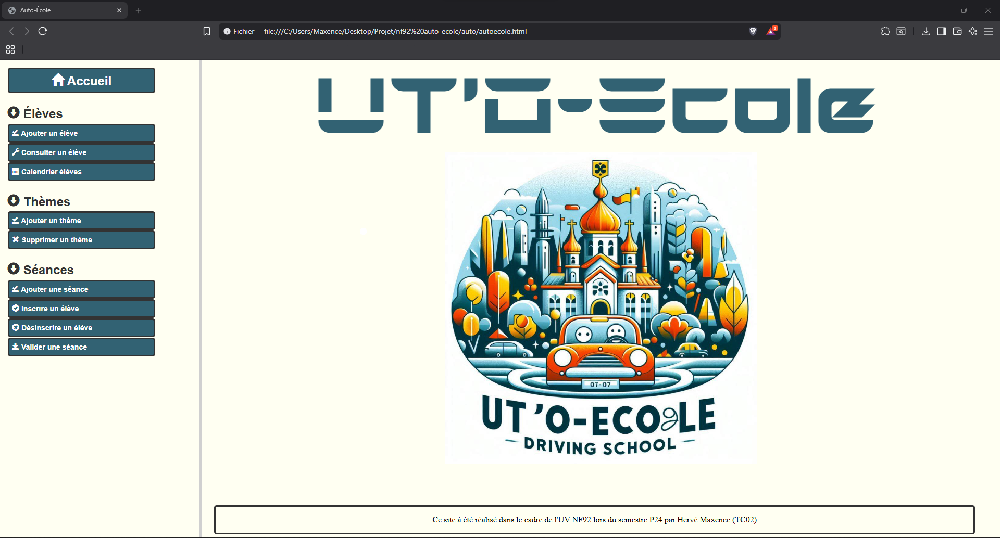

# Driving School Management Platform

Web application that manages the day-to-day operations of a driving school: students, lessons, theory themes and results.
Built as a course project at **UTC Compiègne** (fall 2024) to practise relational database design and server-side web development.

## Features

- **Students** — register a new student, view a student's record and personal lesson calendar
- **Themes** — create and delete the theory themes taught by the school
- **Lessons** — schedule a lesson on a theme, enrol students, unenrol them, and validate the lesson
- **Results** — record each student's score after a lesson

## Architecture

Each feature follows the same two-step pattern: a form page collects the input, then a PHP script processes it and runs the SQL query.

| Feature | Form page | Processing script |
|---|---|---|
| Add a student | `ajout_eleve.html` | `ajouter_eleve.php` |
| Schedule a lesson | `ajout_seance.php` | `ajouter_seance.php` |
| Add a theme | `ajout_theme.html` | `ajouter_theme.php` |
| Delete a theme | `suppression_theme.php` | `supprimer_theme.php` |
| Enrol a student | `inscription_eleve.php` | `inscrire_eleve.php` |
| Unenrol a student | `desinscription_seance.php` | `desinscrire_seance.php` |
| Validate a lesson | `validation_seance.php` | `valider_seance.php` |
| View a student | `consultation_eleve.php` | `consulter_eleve.php` |
| Student calendar | `visualisation_calendrier_eleve.php` | `visualiser_calendrier_eleve.php` |

File names are in French, as the project was delivered for a French-speaking course.

## Tech stack

- **Front-end:** HTML, CSS
- **Back-end:** PHP
- **Database:** MySQL
- **Local environment:** XAMPP / WAMP

## Run it locally

1. Install XAMPP (or WAMP) and start Apache and MySQL.
2. Clone the repository into the `htdocs` folder.
3. Create a database and import `schema.sql` through phpMyAdmin.
4. Copy `config.example.php` to `config.php` and fill in your database credentials.
5. Open `http://localhost/Driving-School-Web-Platform/accueil.html`.

`config.php` is listed in `.gitignore`, so credentials never reach the repository.

## What I would improve today

- Move every query to PDO with prepared statements
- Separate views from logic (MVC structure)
- Add an authentication layer with hashed passwords and roles (staff / student)
- Add automated tests for the enrolment and validation rules
